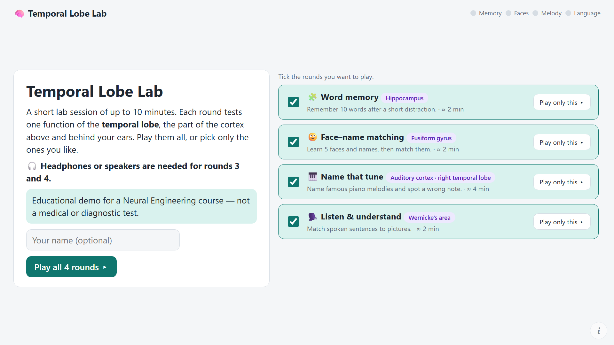
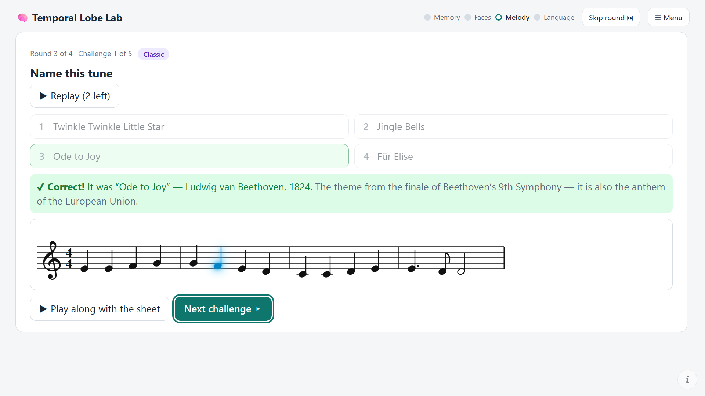
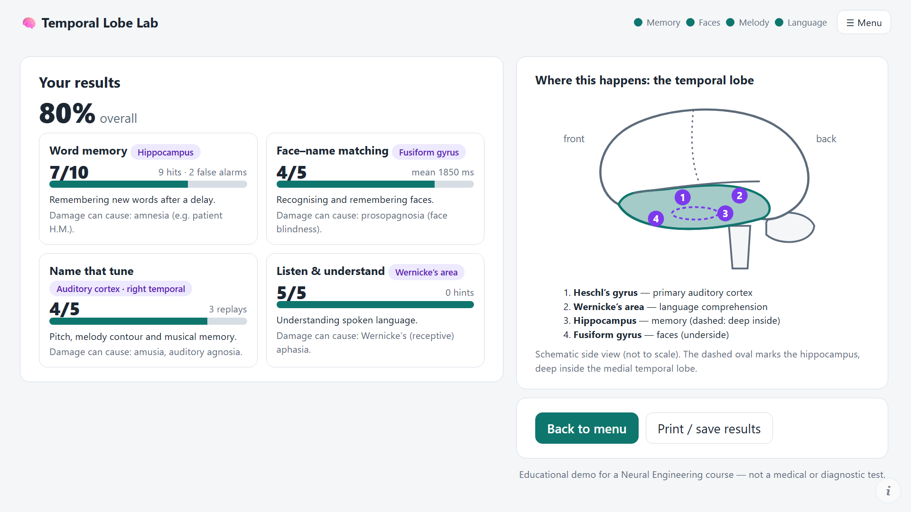

# 🧠 Temporal Lobe Lab

A short browser game that tests four functions of the **temporal lobe** — memory, face recognition, melody recognition and language comprehension. Made for the *ET4265E – Neural Engineering* course.

### ▶ [Play it here](https://hung-nd233960.github.io/temporal-lobe-lab/)

Runs in any current desktop browser (Chrome or Edge recommended), no installation, works offline once loaded. **Turn your sound on** (rounds 3 and 4 use audio). Press F11 for full screen.

> **Educational demo — not a medical or diagnostic test.** Scores are affected by attention, hearing and your audio equipment, and the tasks have not been validated.

## The four rounds

You can play all of them, tick only the ones you like, or press **Play only this** on a single round. During play, **Skip round** and **Menu** buttons are always available.

| Round | What you do | Function | Brain region | If damaged |
|---|---|---|---|---|
| 1. Word memory | Study 10 words, solve 4 sums, then pick the words you saw among 20 | Delayed declarative memory | Hippocampus | Anterograde amnesia |
| 2. Face–name matching | Learn 5 drawn faces with names, then name each face | Face recognition, associative memory | Fusiform gyrus | Prosopagnosia |
| 3. Name that tune | Name 5 short piano melodies — including one in a different key and one with a wrong note | Pitch, melody contour, musical memory | Auditory cortex, right superior / anterior temporal lobe | Amusia |
| 4. Listen & understand | Hear a sentence and pick the matching picture | Language comprehension | Wernicke's area | Wernicke's aphasia |

After each melody the game reveals the answer, shows it as **sheet music** and can play it again with each note lighting up. In the wrong-note challenge it shows the wrong and the correct version one above the other and plays them in turn.

### Controls

| Key | Action |
|---|---|
| `1`–`4` | choose an answer |
| `Space` | play / replay a melody or sentence |
| `Enter` | continue |
| `Esc` | close the credits panel |

## Credits and licences

The credits panel is behind the **(i)** button in the bottom-right corner of the game.

- **Piano:** Salamander Grand Piano samples by Alexander Holm, licensed [CC BY 3.0](https://creativecommons.org/licenses/by/3.0/) (MP3 set as distributed with Tone.js: `tonejs.github.io/audio/salamander`).
- **Melodies:** Ode to Joy, Symphony No. 5 and Für Elise (Beethoven), Gran Vals / the Nokia tune (Tárrega, 1902) and Twinkle Twinkle Little Star (traditional) are in the public domain. The notes were typed in by hand.
- **Faces** are drawn by the game from simple shapes; no real people are shown.
- **Spoken sentences** (round 4) use your browser's built-in text-to-speech voices; Microsoft Edge's "Natural" voices sound best.
- The game stores nothing and sends no data anywhere; it is one self-contained HTML file.

## Project notes

The game is part of a Neural Engineering homework on the temporal lobe (anatomy, functions, EEG and MRI of normal and abnormal function, and a cognitive game). It is a single static file, `index.html`, hosted with GitHub Pages.

Open `index.html?fast=1` to shorten the study phases (useful for testing).
